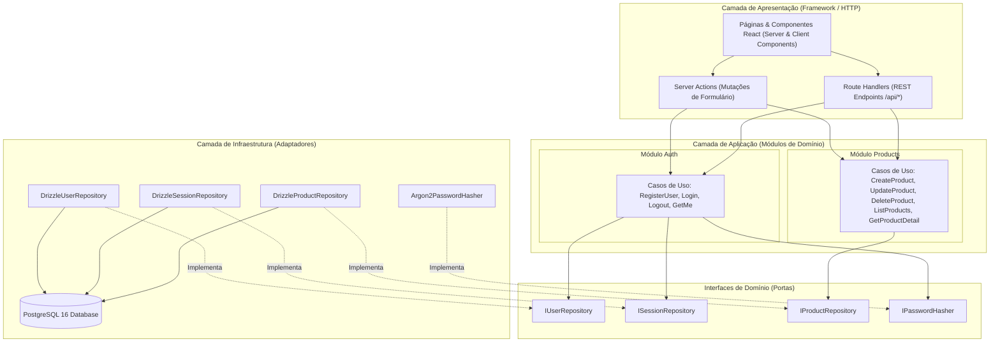
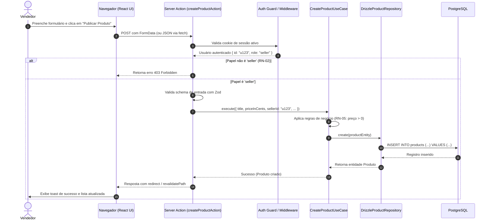

# 02 - Arquitetura de Software: Monólito Modular

Este documento descreve a visão arquitetural do Marketplace, a divisão de camadas, as fronteiras modulares e o ciclo de vida de uma requisição.

---

## 1. Visão Geral

Optamos por um **Monólito Modular** construído sobre o ecossistema TypeScript / Next.js (App Router). 

### Por que Monólito Modular e não Microserviços?
1. **Velocidade de Desenvolvimento & Simplicidade Operacional:** Não há overhead de rede entre serviços, gerenciamento de múltiplos repositórios, service discovery ou orquestração complexa (Kubernetes/gRPC) em um produto em estágio inicial.
2. **Fronteiras Nítidas:** Os domínios de negócio (`auth`, `users`, `products`) vivem em módulos isolados com interfaces públicas bem definidas.
3. **Caminho para Extração:** Se um dia o módulo de catálogo precisar escalar independentemente, ele já possui suas próprias entidades, regras de aplicação e repositórios desacoplados da camada HTTP. A extração para um microserviço torna-se um mero recorte de pasta.

---

## 2. Diagrama de Camadas (Clean / Onion Architecture Inspirada)



---

## 3. O Fluxo de uma Requisição (Request Lifecycle)

Vejamos o que acontece quando um usuário vendedor submete a criação de um produto:



---

## 4. Estrutura de Pastas Detalhada

```text
├── .github/
│   └── workflows/
│       └── ci.yml               # Pipeline de validação contínua (Lint, Testes, Build)
├── docker/
│   └── docker-compose.yml       # PostgreSQL 16 para desenvolvimento e testes locais
├── docs/                        # Documentação viva do projeto
│   ├── adr/                     # Architectural Decision Records
│   ├── aprendizado/             # Explicações didáticas de conceitos
│   ├── 01-requisitos.md
│   ├── 02-arquitetura.md
│   ├── 03-modelo-de-dados.md
│   ├── 04-roadmap.md
│   ├── 05-plano-de-testes.md
│   └── 06-roteiro-validacao.md
├── src/
│   ├── config/                  # Variáveis de ambiente validadas (env.ts)
│   ├── infra/                   # Drivers de banco, migrações e logger
│   │   ├── db/
│   │   │   ├── client.ts        # Conexão Drizzle + Postgres.js pool
│   │   │   ├── schema.ts        # Esquema relacional central ou export dos módulos
│   │   │   └── migrations/      # Arquivos SQL gerados pelo Drizzle Kit
│   │   └── logger/              # Logger estruturado seguro (sem vazar credenciais)
│   ├── modules/                 # MONÓLITO MODULAR (Fronteiras de Domínio)
│   │   ├── auth/                # Módulo de Autenticação e Sessões
│   │   │   ├── domain/          # Entidades (Session, Credentials), interfaces de portas
│   │   │   ├── application/     # Casos de uso (LoginUseCase, RegisterUseCase, etc.)
│   │   │   └── infrastructure/  # Repositório de sessões, Argon2Hasher, cookie helper
│   │   ├── users/               # Módulo de Gestão de Usuários
│   │   │   ├── domain/          # Entidade User, Role Enum, IUserRepository
│   │   │   ├── application/     # Casos de uso de usuário
│   │   │   └── infrastructure/  # DrizzleUserRepository
│   │   └── products/            # Módulo de Catálogo e Produtos
│   │       ├── domain/          # Entidade Product, IProductRepository
│   │       ├── application/     # CreateProduct, UpdateProduct, DeleteProduct, ListProducts
│   │       └── infrastructure/  # DrizzleProductRepository
│   ├── app/                     # Camada de Apresentação (Next.js 14+ App Router)
│   │   ├── (auth)/              # Rotas públicas de login e registro
│   │   ├── (marketplace)/       # Rotas públicas do catálogo e detalhes
│   │   ├── dashboard/           # Rotas protegidas (gerenciamento de produtos do seller)
│   │   └── api/                 # Endpoints REST (se aplicável)
│   └── shared/                  # Utilitários compartilhados, erros de domínio padrão
├── tests/
│   ├── unit/                    # Testes unitários puros com repositórios em memória
│   ├── integration/             # Testes de repositório e serviços com Postgres real
│   ├── e2e/                     # Testes de ponta a ponta com Playwright
│   └── helpers/                 # Setup de banco de testes, factories e fakes
├── drizzle.config.ts
├── package.json
├── tsconfig.json
└── PROJECT_BRIEF.md
```

---

## 5. Como a Arquitetura Suporta o Crescimento

1. **Injeção de Dependências & Princípio da Inversão de Dependência (DIP):**
   Os casos de uso recebem interfaces (`IProductRepository`), não implementações diretas. No teste unitário, passamos um `InMemoryProductRepository`. Em produção, passamos o `DrizzleProductRepository`.
2. **Zero Acoplamento da Regra de Negócio com o Framework Web:**
   Se decidirmos trocar o Next.js por Fastify, ou adicionar um CLI / bot no Telegram, os arquivos em `src/modules/*/application` permanecem 100% inalterados.
3. **Escalabilidade de Banco:**
   Todas as queries usam índices apropriados. A autenticação utiliza consultas indexadas por token hash. A paginação usa `limit` e `offset` indexados (com caminho aberto para paginação baseada em cursor).

