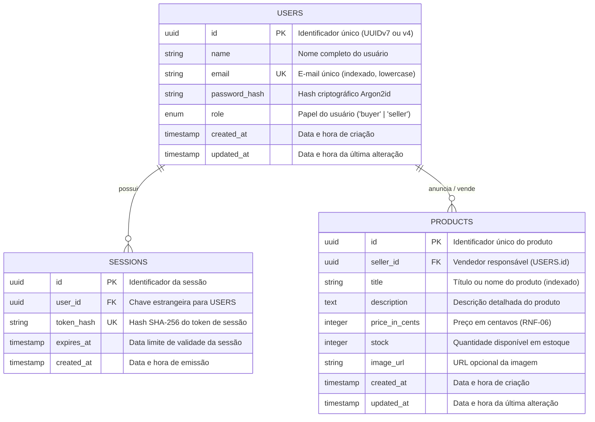

# 03 - Modelo de Dados e Esquema Relacional

Este documento detalha o modelo relacional do Marketplace para o PostgreSQL 16, gerenciado via **Drizzle ORM**.

---

## 1. Diagrama Entidade-Relacionamento (ERD)

---

## 2. Detalhamento das Tabelas

### 2.1 Tabela `users`
Armazena as credenciais de acesso, perfil básico e papel de controle de acesso (RBAC).

| Coluna | Tipo SQL | Restrições | Descrição |
| :--- | :--- | :--- | :--- |
| `id` | `UUID` | `PRIMARY KEY`, `DEFAULT gen_random_uuid()` | Identificador universal único. |
| `name` | `VARCHAR(120)` | `NOT NULL` | Nome completo de exibição. |
| `email` | `VARCHAR(255)` | `NOT NULL`, `UNIQUE` | E-mail de login (armazenado sempre em minúsculas). |
| `password_hash`| `VARCHAR(255)` | `NOT NULL` | Hash da senha gerado com Argon2id. |
| `role` | `VARCHAR(20)` / `ENUM`| `NOT NULL`, `DEFAULT 'buyer'` | Papel no sistema: `'buyer'` ou `'seller'`. |
| `created_at` | `TIMESTAMP WITH TIME ZONE` | `NOT NULL`, `DEFAULT NOW()` | Timestamp de registro. |
| `updated_at` | `TIMESTAMP WITH TIME ZONE` | `NOT NULL`, `DEFAULT NOW()` | Timestamp de modificação. |

- **Índices:**
  - `idx_users_email` (B-Tree em `LOWER(email)`) para busca instantânea no login.

---

### 2.2 Tabela `sessions`
Gerencia as sessões ativas com autenticação stateful segura.

> **Importante para a Segurança:** Nunca armazenamos o token de sessão em texto puro no banco de dados. Armazenamos apenas o `SHA-256(token)`. Se o banco vazar em um dump acidental, as sessões ativas dos usuários não podem ser sequestradas.

| Coluna | Tipo SQL | Restrições | Descrição |
| :--- | :--- | :--- | :--- |
| `id` | `UUID` | `PRIMARY KEY`, `DEFAULT gen_random_uuid()` | Identificador do registro de sessão. |
| `user_id` | `UUID` | `NOT NULL`, `REFERENCES users(id) ON DELETE CASCADE` | Usuário proprietário da sessão. |
| `token_hash` | `CHAR(64)` | `NOT NULL`, `UNIQUE` | Hash SHA-256 do token entregue no cookie. |
| `expires_at` | `TIMESTAMP WITH TIME ZONE` | `NOT NULL` | Momento em que a sessão é considerada inválida. |
| `created_at` | `TIMESTAMP WITH TIME ZONE` | `NOT NULL`, `DEFAULT NOW()` | Momento do login. |

- **Índices:**
  - `idx_sessions_token_hash` (B-Tree em `token_hash`) para validação em O(1) de cada requisição.
  - `idx_sessions_expires_at` para rotina de limpeza de sessões expiradas.

---

### 2.3 Tabela `products`
Armazena o catálogo de produtos anunciados pelos vendedores.

| Coluna | Tipo SQL | Restrições | Descrição |
| :--- | :--- | :--- | :--- |
| `id` | `UUID` | `PRIMARY KEY`, `DEFAULT gen_random_uuid()` | Identificador do produto. |
| `seller_id` | `UUID` | `NOT NULL`, `REFERENCES users(id) ON DELETE RESTRICT` | Vendedor anunciante. Não permite apagar usuário se ele tiver produtos ativos sem desativá-los antes. |
| `title` | `VARCHAR(160)` | `NOT NULL` | Nome/Título do produto. |
| `description` | `TEXT` | `NOT NULL` | Descrição rica do produto. |
| `price_in_cents`| `INTEGER` | `NOT NULL`, `CHECK (price_in_cents > 0)` | Valor monetário em centavos (ex: R$ 49,90 = `4990`). |
| `stock` | `INTEGER` | `NOT NULL`, `DEFAULT 0`, `CHECK (stock >= 0)` | Quantidade física disponível. |
| `image_url` | `VARCHAR(500)` | `NULL` | Link para foto do produto. |
| `created_at` | `TIMESTAMP WITH TIME ZONE` | `NOT NULL`, `DEFAULT NOW()` | Data de anúncio. |
| `updated_at` | `TIMESTAMP WITH TIME ZONE` | `NOT NULL`, `DEFAULT NOW()` | Última atualização do anúncio. |

- **Índices:**
  - `idx_products_seller_id` (B-Tree) para carregar os produtos do vendedor na área restrita.
  - `idx_products_created_at` (B-Tree DESC) para ordenação rápida na listagem pública.
  - `idx_products_title` (B-Tree ou pg_trgm GIN no roadmap) para busca por nome.

