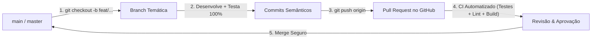

# 07 - Política de Branches, Versionamento e Integração Contínua

Este documento estabelece o padrão formal e inegociável de versionamento do projeto Marketplace, definindo o ciclo de vida do código, o fluxo de branches (Git Flow / GitHub Flow Adaptado) e os critérios de integração.

---

## 1. Regra Fundamental: Proibição de Commit Direto na `main` / `master`

> ⚠️ **DIRETRIZ INEGOCIÁVEL:**
> **É TERMINANTEMENTE PROIBIDO realizar commits ou pushes diretos na branch principal (`main` ou `master`).**
> 
> Nenhuma linha de código entra na branch principal sem antes ter sido desenvolvida em uma branch temática isolada e integrada exclusivamente via **Pull Request (PR)** aprovado.

---

## 2. Tipologia e Convenção de Nomenclatura de Branches

Toda branch deve ser criada a partir da branch principal atualizada e seguir a convenção de prefixos semânticos abaixo:

| Prefixo | Finalidade | Exemplo de Branch |
| :--- | :--- | :--- |
| **`bugfix/`** ou **`fix/`** | Correção de defeitos, bugs, anomalias e falhas de runtime | `bugfix/fix-global-error-boundary`<br>`fix/isolate-test-database` |
| **`feat/`** | Desenvolvimento de novos requisitos e funcionalidades | `feat/password-recovery`<br>`feat/product-image-upload` |
| **`refactor/`** | Reestruturação interna de código sem alteração de comportamento | `refactor/modularize-auth-actions` |
| **`docs/`** | Criação ou atualização de documentação, ADRs e guias | `docs/branching-strategy-guide` |
| **`test/`** | Adição de novos testes ou melhoria de cobertura sem alterar regras | `test/add-e2e-reset-password-flow` |
| **`chore/`** | Tarefas operacionais, atualização de dependências e tooling | `chore/update-drizzle-kit` |

---

## 3. Ciclo de Vida do Desenvolvimento de uma Tarefa



### Passo a Passo Obrigatório:
1. **Sincronização:** Antes de iniciar qualquer trabalho, certifique-se de que sua base local está atualizada:
   ```bash
   git checkout master
   git pull origin master
   ```
2. **Criação da Branch:** Crie a branch específica com o prefixo apropriado:
   ```bash
   # Exemplo para uma correção de bug:
   git checkout -b bugfix/nome-do-problema

   # Exemplo para uma nova funcionalidade:
   git checkout -b feat/nome-da-funcionalidade
   ```
3. **Desenvolvimento e Testes (Zero Bypass):** Desenvolva a funcionalidade ou correção garantindo que todos os testes passem de ponta a ponta (`npm run test` e `npm run build`).
4. **Publicação da Branch:** Envie a branch para o repositório remoto:
   ```bash
   git push -u origin <tipo>/<nome-da-branch>
   ```
5. **Abertura do Pull Request:** Abra o PR no GitHub com descrição clara do que foi implementado, requisitos atendidos e testes executados.
6. **Integração (Merge):** Somente após aprovação do pipeline de CI e validação o PR é integrado à branch principal.

---

## 4. Benefícios Arquiteturais e de Gestão
- **Controle Preciso de Releases:** Sabemos com exatidão quais features e correções compõem cada versão entregue.
- **Isolamento de Erros:** Se uma nova funcionalidade apresentar regressão, ela pode ser revertida de forma cirúrgica sem afetar outras partes do sistema.
- **Rastreabilidade e Governança:** O histórico do repositório torna-se legível, profissional e auditável para qualquer membro da equipe ou investidores.
