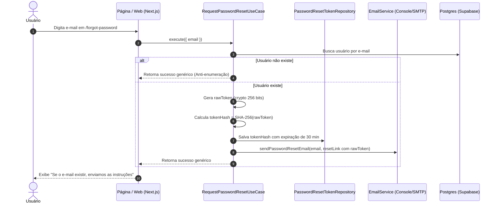

# 08 - Arquitetura de Recuperação de Senha Segura (Padrão OWASP)

## 1. Por que a recuperação de senha é crítica?
A recuperação de senha é uma das funcionalidades com maior superfície de ataque em aplicações web. Se implementada de forma ingênua, ela pode abrir brechas para:
1. **Enumeração de Usuários (User Enumeration):** Um invasor testa listas de e-mails vazados para descobrir quem tem conta na sua plataforma.
2. **Account Takeover via Vazamento de Banco:** Se os tokens temporários estiverem gravados em texto plano no banco de dados, qualquer dump ou leitura indevida permite a um invasor alterar a senha de qualquer usuário.
3. **Replay Attacks:** Um token usado uma vez que continua válido permite que um intermediário altere a senha novamente.
4. **Sessões Zumbis:** O usuário redefine a senha porque suspeitou que foi invadido, mas a sessão ativa que o invasor já abriu no navegador dele continua viva.

---

## 2. As 4 Camadas de Proteção Sênior Adotadas

### Camada 1: Proteção Anti-Enumeração
Quando alguém digita `vitima@email.com` no formulário de "Esqueci minha senha":
- **Abordagem Ingênua (Insegura):**
  - "E-mail não encontrado no sistema" ❌ *(O atacante descobre que o e-mail não é cadastrado).*
  - "Link enviado com sucesso" ❌ *(O atacante descobre que o e-mail existe).*
- **Abordagem Sênior (Segura - OWASP):**
  - Resposta sempre neutra: *"Se houver uma conta associada a este e-mail, enviamos as instruções de recuperação."* ✔️
  - O sistema trata internamente: se o e-mail existir, gera o token e envia o e-mail; se não existir, não faz nada, mas retorna a mesma mensagem neutra com tempo de resposta similar.

### Camada 2: Tokens de Alta Entropia com Hash SHA-256 no Banco
- Geramos 32 bytes criptograficamente aleatórios no Node.js:
  ```ts
  const rawToken = crypto.randomBytes(32).toString('hex'); // 64 caracteres hex
  ```
- **O que vai para o e-mail:** O link com o token puro `https://nossoapp.com/reset-password?token=rawToken`.
- **O que vai para o PostgreSQL:** O hash do token:
  ```ts
  const tokenHash = crypto.createHash('sha256').update(rawToken).digest('hex');
  ```
- **Por que fazemos isso?**
  Se alguém conseguir acessar o banco de dados (ex: backup exposto), ele encontrará apenas `token_hash`. Como o SHA-256 é uma função unidirecional (one-way), é matematicamente impossível reverter o hash para obter o `rawToken` que o formulário exige.

### Camada 3: Uso Único e Validade Estrita
- Cada token expira em **30 minutos**.
- Possui uma coluna `used_at`. Quando o usuário define a nova senha, o token é marcado como usado (`used_at = now()`).
- Se alguém tentar usar o mesmo link uma segunda vez, o sistema rejeita.
- Se o usuário pedir um novo link antes de usar o anterior, os tokens pendentes anteriores são invalidados.

### Camada 4: Revogação Total de Sessões Ativas
Ao concluir a redefinição de senha:
- A nova senha é criptografada com **Argon2id** (RNF-01).
- Todas as sessões existentes daquele usuário na tabela `sessions` são deletadas imediatamente:
  ```sql
  DELETE FROM sessions WHERE user_id = $1;
  ```
- Isso garante que, se o usuário redefiniu a senha por desconfiar de vazamento, qualquer invasor conectado é deslogado na hora.

---

## 3. O Fluxo de Execução no Monólito Modular



